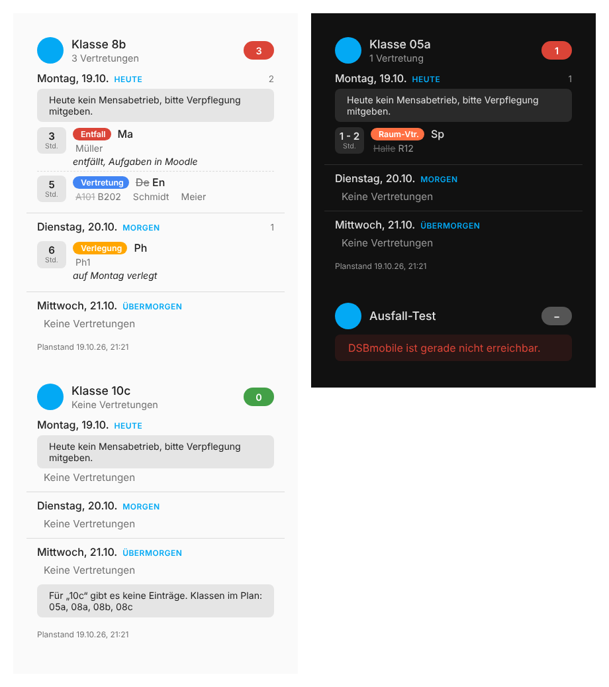

<p align="center">
  <a href="https://my.home-assistant.io/redirect/marketplace_repository/?owner=yannick80&repository=ha-dsb-vertretungsplan&category=integration">
    
  </a>
</p>
<p align="center">
  <a href="https://github.com/yannick80/ha-dsb-vertretungsplan/releases/latest">
    
  </a>
  <a href="https://www.home-assistant.io">
    
  </a>
  <a href="https://github.com/yannick80/ha-dsb-vertretungsplan/actions/workflows/validate.yml">
    
  </a>
  <a href="LICENSE">
    
  </a>
</p>

# DSB Vertretungsplan

DSB Vertretungsplan brings your school's substitution plan ("Vertretungsplan") from **DSBmobile** into Home Assistant.
The plan is loaded **once per school account**; filtering by class happens on the dashboard or in automations, so one account is enough for several children at the same school.



<!-- ha-marketplace:exclude-start -->
**Contents:**
[What you get](#what-you-get) ·
[Before you start](#before-you-start) ·
[Installation](#installation) ·
[Set up](#set-up) ·
[Entities](#entities) ·
[Dashboard card](#dashboard-card) ·
[Action `get_entries`](#action-dsb_vertretungsplanget_entries) ·
[Troubleshooting & FAQ](#troubleshooting--faq) ·
[For developers](#for-developers)
<!-- ha-marketplace:exclude-end -->

## What you get

- **One card per child.** A dashboard card with a visual editor shows the substitutions for one class. It ships with the integration; no second repository and no manual resource entry.
- **Notifications per class.** The action `dsb_vertretungsplan.get_entries` returns the entries of the coming days for one class, ready for a morning notification.
- **Calendar.** The next substitution as a calendar event, for the calendar card and calendar triggers.
- **Reliable data.** Uses the same API as the DSBmobile app, no web scraping. When DSB is unreachable, the last good plan is kept and the entities become *unavailable* instead of dropping to 0. An empty plan during the holidays is a valid state.
- **Understands Untis plans.** Columns are detected by their header, changed values (`<s>old</s> new`, `old?new`) are recognised, merged classes such as `08abc` are expanded to `08a, 08b, 08c`, and several days per file work.
- **Easy upkeep.** Re-authentication, reconfiguration, options without restart, diagnostics download, English and German user interface.

## Before you start

- [ ] **Home Assistant 2025.1 or newer.**
- [ ] **Your school publishes its Untis substitution plan through DSBmobile**, and you can see it in the DSBmobile app.
- [ ] **The user ID and password** you use in the DSBmobile app.

<!-- ha-marketplace:exclude-start -->
## Installation

### Home Assistant 2026.11 and newer (Marketplace)

**One click:** select this button, then confirm in your Home Assistant.

[](https://my.home-assistant.io/redirect/marketplace_repository/?owner=yannick80&repository=ha-dsb-vertretungsplan&category=integration)

**Or by hand:**

1. In Home Assistant, go to **Settings** > **Marketplace**.
2. In the upper-right corner, select **Add from link**.
3. Under **GitHub link**, enter `https://github.com/yannick80/ha-dsb-vertretungsplan`. If Home Assistant asks for the type, choose **Integration**.
4. Open DSB Vertretungsplan and select **Install**.
5. Restart Home Assistant.

### Home Assistant 2026.10 and older (HACS)

[](https://my.home-assistant.io/redirect/hacs_repository/?owner=yannick80&repository=ha-dsb-vertretungsplan&category=integration)

1. Open **HACS** in the sidebar.
2. Select the three dots in the upper-right corner, then **Custom repositories**.
3. Enter `https://github.com/yannick80/ha-dsb-vertretungsplan`, choose the type **Integration**, and select **Add**.
4. Open DSB Vertretungsplan and select **Download**.
5. Restart Home Assistant.

### Manual installation

1. Download the source code of the [latest release](https://github.com/yannick80/ha-dsb-vertretungsplan/releases/latest).
2. Copy the folder `custom_components/dsb_vertretungsplan` to `config/custom_components/` (create the folder if it does not exist).
3. Restart Home Assistant.
<!-- ha-marketplace:exclude-end -->

## Set up

1. Go to **Settings** > **Devices & services** > **Add integration** and search for **DSB Vertretungsplan**.
2. Enter the user ID and password as used in the DSBmobile app.

Under **Configure** you can change later:

| Option           | Default | Meaning                                                     |
|------------------|---------|-------------------------------------------------------------|
| Preview in days  | 3       | The sensor contains entries from today up to N days ahead   |
| Polling interval | 30 min  | How often DSB is queried (minimum 5 min)                    |

## Entities

All entities belong to the device "DSBmobile *user ID*". Entity IDs below are the German ones; with an English Home Assistant UI the suffixes are translated (`substitution_plan`, `plan_updated`, ...).

| Entity                                    | State                                    | Attributes                                                   |
|-------------------------------------------|------------------------------------------|--------------------------------------------------------------|
| `sensor.dsbmobile_<id>_vertretungsplan`   | number of entries (all classes, N days)  | `days` (per day: `date`, `day_label`, `count`, `info`), `classes` (all classes that have entries), `plan_days`, `plan_updated`, `from`, `to`, `days_ahead` |
| `calendar.dsbmobile_<id>_vertretungsplan` | next entry as an all-day event           | for the calendar card and calendar triggers                  |
| `sensor.dsbmobile_<id>_planstand`         | time the plan was last published         |                                                              |
| `sensor.dsbmobile_<id>_nachrichten`       | number of news items                     | `news`                                                       |
| `sensor.dsbmobile_<id>_dokumente`         | number of documents                      | `documents`                                                  |
| `sensor.dsbmobile_<id>_plane`             | number of plans (diagnostic)             | `plans`, `plan_days`, `errors`                               |
| `sensor.dsbmobile_<id>_letzte_abfrage`    | last successful poll (diagnostic)        |                                                              |

`days` contains **every plan day inside the window**, including days without entries (`count: 0`). The entries themselves are deliberately not exposed as attributes: the plan of a whole school quickly exceeds the 16 kB Home Assistant allows for state attributes. The card fetches entries through the websocket command `dsb_vertretungsplan/entries`, automations through the action `dsb_vertretungsplan.get_entries` (see below). An entry looks like this:

```yaml
date: "2026-10-19"
day_label: "19.10.2026 Montag"
type: "Vertretung"              # Untis column "Art"
classes: "08abc"                # column "Klasse(n)" as delivered by Untis
class_list: ["08a", "08b", "08c"]   # expanded and normalised
lesson: "5"
subject: "En"
room: "B202"
substitute: "Schmidt"           # "Vertr. von" / "Vertreter"
teacher: "Meier"                # "(Le.) nach" / "Lehrer"
text: ""
changes: { subject: "De", room: "A101" }   # previous values of changed fields
columns: { "Art": "Vertretung", "(Fach)": "De → En", ... }   # every column, raw
```

## Dashboard card

The integration ships its own dashboard card and registers it automatically as a dashboard resource (visible under **Settings** > **Dashboards** > **Resources**; do not remove it). If your resources are managed in YAML (`lovelace: resource_mode: yaml`), the card is loaded as an extra script instead.

1. Open a dashboard, select the pencil, then **Add card**.
2. Search for **DSB Vertretungsplan**.
3. Pick the sensor and the class. For a second child, add the card again with another class; both read the same sensor.

In YAML:

```yaml
type: custom:dsb-vertretungsplan-card
entity: sensor.dsbmobile_123456_vertretungsplan
class: "08b"
```

| Option             | Default              | Meaning                                                                   |
|--------------------|----------------------|---------------------------------------------------------------------------|
| `entity`           |                      | the "Vertretungsplan" sensor (required)                                   |
| `class`            | empty                | class, e.g. `08b` or `8b`; merged classes such as `08abc` match. Empty = whole school |
| `title`            | "Klasse …"           | custom title                                                              |
| `icon`             | `mdi:school-outline` | header icon                                                               |
| `days`             | 0                    | number of days; 0 = window of the integration                             |
| `hide_today_after` | empty                | time (`HH:MM`) after which today is hidden, e.g. `08:00` once school has started. Counter and badge then only count the following days |
| `show_empty_days`  | `true`               | show days without entries as "Keine Vertretungen"                         |
| `show_info`        | `true`               | show the day notes ("Nachrichten zum Tag")                                |
| `show_footer`      | `true`               | show the plan timestamp at the bottom                                     |
| `compact`          | `false`              | lesson, type and subject only                                             |
| `merge_lessons`    | `true`               | show consecutive lessons with identical content as one row (`5-6. Std`)   |

## Action `dsb_vertretungsplan.get_entries`

Returns the entries of the coming days, optionally for one class, as a response. Handy for per-child notifications:

```yaml
triggers:
  - trigger: time
    at: "06:45:00"
actions:
  - action: dsb_vertretungsplan.get_entries
    data:
      class_name: "08b"
      days_ahead: 1
    response_variable: plan
  - if:
      - condition: template
        value_template: "{{ plan.count > 0 }}"
    then:
      - action: notify.mobile_app_phone
        data:
          title: "Vertretungsplan 08b today"
          message: >-
            
            {{ e.lesson }}. Std {{ e.type }} {{ e.subject }}{{ ' (' ~ e.text ~ ')' if e.text }}
            
```

Response: `class_name`, `from`, `to`, `count`, `classes`, `plan_updated`, `entries` (flat) and `days` (grouped by day, each with `entries`). `days_ahead` overrides the window per call; `config_entry` is only needed with several DSB accounts.

## Troubleshooting & FAQ

### The card finds nothing for my class

If the plan has entries but none match the configured class, the card lists the classes present in the plan, so you can check how your school spells them (`8b`, `08b`, `08abc`, …).

### The card still looks old after an update

The browser loads the new card through the version in its URL. If it still looks old, reload the page once with the cache cleared.

### Login works in the app but not in Home Assistant, or columns are missing

Check login and parser against your school without Home Assistant (runs on Python 3.9 and newer):

```bash
python3 -m pip install aiohttp beautifulsoup4
python3 scripts/dsb_check.py USER PASSWORD 08b
```

The script prints all plans and the parsed entries including `class_list`, and saves the raw HTML as `scripts/plan_<n>.html`. If your school's columns are not recognised, attach that file to an issue; it is what `parser.py` (table `_HEADER_MAP`) needs to be adapted.

### Debug logs and diagnostics

```yaml
logger:
  logs:
    custom_components.dsb_vertretungsplan: debug
```

**Settings** > **Devices & services** > **DSB Vertretungsplan** > **Download diagnostics** contains all fetched data, with credentials and URLs removed.

## For developers

```bash
pip install -r requirements-test.txt
ruff check custom_components tests scripts
pytest tests/
```

See [CHANGELOG.md](CHANGELOG.md) for what changed.

**Releasing:** bump `version` in `custom_components/dsb_vertretungsplan/manifest.json`, move the CHANGELOG entry to the new version, then publish a GitHub release with the tag `vX.Y.Z`.

## Disclaimer

This project is independent and not affiliated with, endorsed by, or supported by DSB / heinekingmedia GmbH or Untis GmbH. The names are used only to say which service the integration works with.

The integration uses the undocumented API of the DSBmobile app with your own DSBmobile account. It is not an official interface: DSB can change or block it at any time, and the integration may then stop working. Keep the polling interval reasonable (the minimum is 5 minutes).

## License

[MIT](LICENSE)
